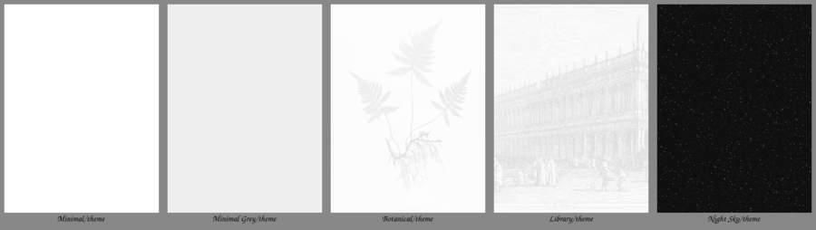

# Bookshelf

Home-screen plugin by AndyHazz, used instead of Simple UI and Project: Title.
Repo: https://github.com/AndyHazz/bookshelf.koplugin · Guide: https://andyhazz.github.io/bookshelf-docs/

## Installed

- Version: v6.0.4 (`bookshelf.koplugin.zip`, sha256 `b8ac73bb09dbf202062b721f9d137a0961f2474281bdd8070ca0b070772a8ba6`)
- Needs KOReader v2025.08 or newer (device: v2026.07.2). Updates install from inside KOReader: Bookshelf > Updates.
- Location: `.adds/koreader/plugins/bookshelf.koplugin`
- Needs Cover Browser **enabled**, so `projecttitle` is in `plugins_disabled` instead (Project: Title refuses to run alongside Cover Browser).

## Why Bookshelf over Simple UI

From the 2026-10-27 run of https://github.com/d1-m4ss/kindle_benchmark (emulator, KOReader v2026.07.2): Bookshelf is close to stock KOReader in startup and memory (+5–6 MiB heap); Simple UI is the heaviest tested (66–86 MiB heap, ~8x stock time to close a book). Bookshelf's own shelf pages faster with its page animation turned off.

Night mode is on on this device, which is the likely trigger of the Simple UI crash (`BB_invert_blit_from` with a colour image). Bookshelf has explicit night-mode and B&W handling.

## Setting it as the start screen

`start_with` was left as `filemanager` for the first boot, so a crash can't loop. Once Bookshelf works, set it from the file browser menu, first tab > Start with > bookshelf.

## Undo

- Back to Project: Title: disable Bookshelf and Cover browser, enable Project: Title in Plugin management, restart. (Or restore `settings.reader.lua.pre-bookshelf` on the device.)
- If KOReader won't start: add `["bookshelf"] = true` to `plugins_disabled` and set `start_with` to `"filemanager"` in `settings.reader.lua` over USB.

## Minimal theme packs (made for this device)

The built-in oak plank was too busy, so these replace wood with flat, grain-free, shadowless shelves. They live in `config/.adds/koreader/settings/bookshelf/ornaments/` and on the device in the same place.

| Pack | What it is |
|---|---|
| **Minimal** | Theme: white page, a 4px black rule as the shelf, black-and-white colours, dark set for night mode. |
| **Minimal Grey** | Theme: soft grey page, flat graphite shelf. |
| **Smooth planks** | Not a theme, just four planks for the plank picker: Hairline, Paper, Graphite, Ink. |

Choose one: top menu > Bookshelf > Theme > This shelf (or Default theme for every shelf). Planks on their own: Theme > Plank > Smooth planks tab.

No wallpaper or ornaments, on purpose. The two potted plants Bookshelf seeds into the ornaments folder (`template.svg`, `cactus.svg`) can be turned off under Theme > Ornaments, or deleted (they don't come back).

Planks are regenerated with `tools/make_planks.sh <outdir> <Name> <surface> <highlight> <front> <outline> 0` (needs ImageMagick 7). Same canvas as the built-in oak: 960x360 middle, 220x360 ends, top surface y120-214, front edge y216-238.

## Art theme packs (made for this device)

Three themes with pictures, also in `settings/bookshelf/ornaments/`. Every plank is flat (no wood). All art is greyscale so it reads on the Clara BW.

| Pack | Wallpaper | Shelf | Ornaments |
|---|---|---|---|
| **Botanical** | Bradbury's fern engraving, faded to a pale wash | Paper (white) | Four framed plant prints: Fern, Turban lily, Cape lily, Flowering rush |
| **Library** | Canaletto, *The Library, Venice*, faded | Ink (black) | Drawn candle, globe, hourglass |
| **Night Sky** | Generated star field (dark theme) | Graphite | Drawn moon and telescope |

All prints are CC0 from the Cleveland Museum of Art Open Access collection; each pack's `CREDITS.txt` lists them. Each theme has day and night colours (written as they should look; Bookshelf inverts them itself for night mode).

Rebuild with `tools/make_art_packs.sh <art_dir> <out_dir>` (ImageMagick 7). `<art_dir>` holds the museum print JPEGs (`1993.45_print.jpg`, `2020.164_print.jpg`, `1955.142_print.jpg`, `1955.144_print.jpg`, `1925.1239.15_print.jpg` from openaccess-cdn.clevelandart.org). It also builds its own copies of Minimal, Minimal Grey and Smooth planks; only the three art packs were installed from it.
